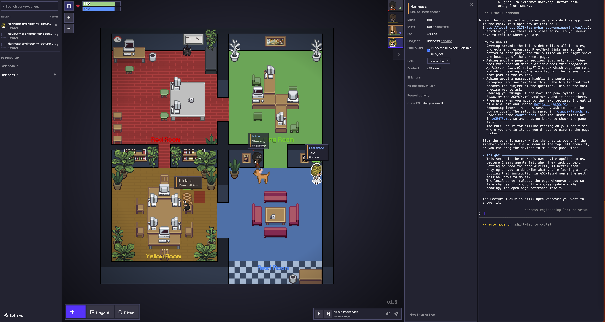
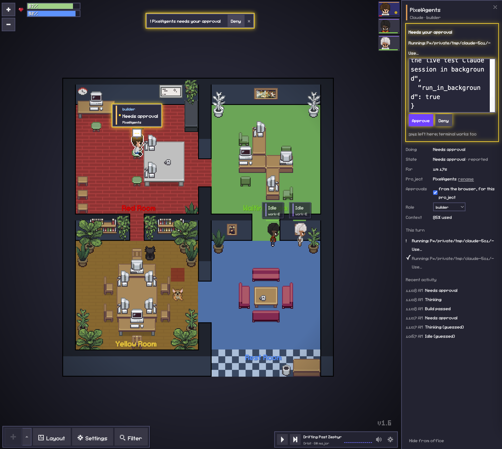
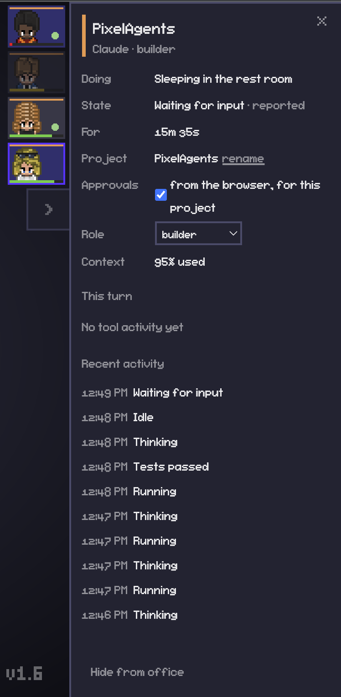
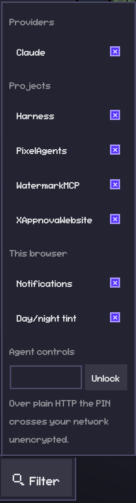
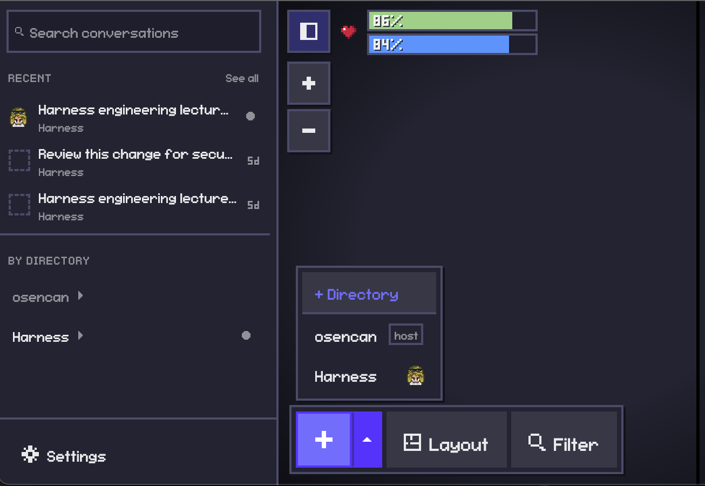

<h1 align="center">
  
</h1>

<div align="center">

[](LICENSE)
[](CHANGELOG.md)
[](https://github.com/sponsors/osencan)

</div>

<div align="center">
<a href="#getting-started">🚀 Getting started</a> • <a href="#the-office-at-a-glance">👀 The office</a> • <a href="#agent-controls">🎛️ Agent controls</a> • <a href="#privacy-and-security">🔒 Privacy</a> • <a href="FORK.md">🆕 What's new in 2.0</a>
</div>

<br/>

Pixel Agents turns the AI coding agents running in your terminals into animated pixel-art characters working in a tiny office. They walk to their desks, type when they're editing, read when they're searching, and light up when they need you.

**Version 2.0** is built for watching and steering many **Claude Code** and **Codex** sessions from a browser, including from your phone over your LAN. It adds honest, reported statuses; a detail panel for every agent; per-browser filtering and hiding; rooms with a purpose; and, behind a PIN, the ability to approve permission requests, start new agents and type into them from the browser.

<!-- Screenshot: the office with several agents, labels and rooms. -->



## Features

### Watching

- **Claude Code and Codex**: Claude sessions are tracked through hooks (with transcripts as a fallback). Local Codex sessions are read from their rollout logs, read-only. Subagents and teammates appear as their own characters, linked to their parent.
- **Correct identity and project names**: each session keeps its own character. Labels follow the session's real project: git root, symlinks resolved, worktrees grouped with their main repo, same-named projects told apart. You can pin a friendlier name.
- **Honest statuses**: thinking, planning, reading, editing, running, waiting for permission or for input, idle, or no recent activity. Each is marked **reported** (from a hook or log) or **guessed**. Only a real permission request means "needs approval".
- **Detail panel**: click a character to see what it's doing, for how long, what it's asking for, this turn's tool steps, its subagents and parent, context use, and recent history.
- **Quiet notifications** for approval requests, finished turns, failed tools and test/build results.
- **Rooms with a purpose**: give each painted area a purpose (Work, Rest, Waiting or Planning). Idle agents walk to the rest room and doze after a while, permission waits can queue in a waiting room, and Claude sessions in plan mode can gather in a planning room.

### Your own view (per browser)

- **Filter** by provider and project, and **hide** agents without removing them: their card stays, faded, until you unhide it.
- Role badges you assign, project color accents, desk memory per project, and an optional day/night tint.

### Steering (opt-in, behind a PIN off this machine)

- **Approve or deny** a Claude permission request from the agent's panel, with the full request shown. Your terminal prompt keeps working in parallel: whichever answers first wins.
- **Hire agents** into your listed folders and **type into them** in the browser's terminal drawer.

### The office

- **Office layout editor**: floors, walls, furniture, pets and named Areas. Layouts are saved and exported as JSON, and external asset packs are supported.
- **Your own team**: a character editor with wardrobe, colors, a pixel editor and custom items.
- **Recent conversations**, **usage and context bars**, and the **office radio**.

<p align="center">
  
  
</p>

<p align="center">
  
</p>

## Requirements

- [Claude Code](https://docs.anthropic.com/en/docs/claude-code) installed and signed in. Codex is optional and detected if present.
- Node.js 20 or later
- macOS, Linux or Windows. Pixel Agents 2.0 is developed and tested on macOS with the **standalone browser app**. The VS Code extension builds from the same source but is untested here.

## Getting started

Version 2.0 isn't published to npm; run it from source:

```bash
git clone https://github.com/osencan/PixelAgents.git
cd PixelAgents
npm ci
npm run build
node dist/cli.js                                   # this machine only
node dist/cli.js --host 192.168.1.20 --port 3100   # also reachable on your LAN
```

The server prints a private URL with a `?token=`: open it to arrange the office and use the controls. Opening the plain address without the token, from any device, gives a **read-only** view. Treat the token URL as a secret.

Useful options:

```bash
node dist/cli.js --port 3100        # a fixed port (bookmarks keep working)
node dist/cli.js --no-terminal      # watch-only: no hiring agents, no terminals
node dist/cli.js --help
```

The first time, the browser asks your consent before installing Claude Code hooks into `~/.claude/settings.json`. Turn on **Settings → Watch All Sessions** to see sessions from every project. To turn off Codex detection, start with `PIXEL_AGENTS_CODEX=0`.

## The office at a glance

| You see                         | It means                                                             |
| ------------------------------- | -------------------------------------------------------------------- |
| Label above a character         | What it's doing, plus its project (a color stripe marks the project) |
| Pulsing amber **!** or glow     | Waiting for your approval (only when Claude really asked)            |
| `approval?` after the activity  | A guess: a tool has run a while without news                         |
| **Zz** / Sleeping               | Reported idle in the rest room past the sleep delay                  |
| ✓ Tests passed / ✗ Build failed | A test or build command just finished (real outcome)                 |
| Dashed lines (selected agent)   | Links to its parent or children                                      |

<p align="center">
  
</p>

**Filter** (bottom toolbar, right of Settings; on phones and read-only pages it floats at the top) holds the provider/project filter, the notifications and tint switches, and **Agent controls**.

## Agent controls

Steering is off for everyone until it's allowed:

1. **On the server's machine**, the token URL has control. Set a **control PIN** (6–12 digits) in **Filter → Agent controls**.
2. **On another device** (phone, tablet), open the token URL, then **Filter → Agent controls → Unlock** with the PIN. An unlock lasts until you lock it or after 30 idle minutes. Five wrong PINs lock that device out for 15 minutes.
3. **Approvals are opt-in per project**: in an agent's panel, tick **Approvals: from the browser, for this project**.

Then:

- **Approve / Deny**: when an opted-in Claude session asks permission, its panel shows the full request with **Approve** and **Deny** (notifications offer Deny only). Requests too long to show in full can only be denied here; approve them in the terminal.
- **Hire an agent**: **+** opens the launch drawer. Pick one of your **Directories** (add them with **+ Directory**) and Claude starts in a terminal owned by the office. Its card opens the terminal drawer, where you can type. The **×** on its card ends it, after a confirm.
- **Sessions you started yourself** can't be typed into from the office. To message them from a browser or the Claude app, start them with Claude's official [Remote Control](https://code.claude.com/docs/en/remote-control): `claude --remote-control`.

<p align="center">
  
</p>

## Privacy and security

- **Read-only viewers** (no token) see tool activity only as categories ("Running a command", "Editing a file"): never file names, commands or prompt text.
- **Control** needs the token plus either the server's own machine or the PIN. Relayed requests (a reverse proxy) also need the PIN.
- **Approvals** are signed with a key that never leaves the machine, so nothing else listening on the port can approve a tool call.
- **Skip-permissions is disabled**: agents launched here always ask.
- **Audit log**: every control action is appended to `~/.pixel-agents/control-audit.jsonl`, with what, when and from where, but never PINs, commands or prompts.
- **Over plain HTTP**, the token and PIN cross your network unencrypted. Prefer HTTPS (for example `tailscale serve` with `--allowed-host`) if your network isn't trusted.

## Customizing the office

### Layout and rooms

Click **Layout** to paint floors, walls and carpets, place and recolor furniture, add pets, and paint named **Areas**. In the **Areas** panel each room has a **purpose** (Work, Rest, Waiting, Planning). Also set when agents fall asleep in the rest room, and whether permission waits walk to the waiting room. Layouts can be exported and imported as JSON.

### Office assets

Use **Settings → Add Asset Directory** to load external characters, pets and furniture. See [docs/external-assets.md](docs/external-assets.md) for the furniture format. `scripts/asset-manager.html` helps create manifests.

### Directories

A Directory is a folder you can launch agents into. **+** opens the drawer, and **+ Directory** adds one: a name, a path, and optionally its preferred Areas and default characters. Agents can only be launched into listed Directories. **Settings → Show Start Directory** also lists the folder the server started in.

### Characters

Open the roster from the arrow beside **+** and press a character's pencil (or **+ New**) for the **Characters** view: dress from the wardrobe, recolor pieces and edit pixels, then **Save**. Characters export as PNG or config files, and the roster as a zip.

## How it works

- **Claude hooks** (default): a hook script sends Claude Code events (`SessionStart`, `PreToolUse`, `PermissionRequest`, `Stop`, …) to the running server, which also reads session transcripts under `~/.claude/projects/` for details. For opted-in projects, the hook asks the server for a browser decision on `PermissionRequest` and prints Claude's documented decision output. With no decision, the normal terminal prompt decides.
- **Codex**: rollout logs under `$CODEX_HOME/sessions` are tailed read-only.
- **Statuses** are derived on the server into one lifecycle per agent, replayed on reconnect, with a bounded in-memory history.

Pixel Agents doesn't modify Claude Code. Its hook entries live in `~/.claude/settings.json`, and its own data under `~/.pixel-agents/`.

## Development

```bash
npm run check-types && npm run lint
npm run test:server && npm run test:webview
npm run build
```

See [CONTRIBUTING.md](CONTRIBUTING.md) for the project structure and how an event reaches the office, and [e2e/README.md](e2e/README.md) for the browser test suite. [FORK.md](FORK.md) summarizes what changed in 2.0.

## Troubleshooting

- **Won't start (`EADDRNOTAVAIL`)**: the `--host` address isn't this machine's current IP. Check it, or give the machine a fixed address in your router.
- **An agent is missing**: confirm **Settings → Instant Detection (Hooks)** is on, and turn on **Watch All Sessions** for other projects.
- **No Approve/Deny buttons**: you need control (Filter → Agent controls), the project's approval switch must be on, and the request must come from Claude in that project.
- **Can't hire an agent**: add the folder as a **Directory** first; other folders are refused.
- **The UI looks disconnected**: **Settings → Debug View** shows the connection and agent data.

## Sponsor

If Pixel Agents 2.0 is useful to you, consider [sponsoring its development](https://github.com/sponsors/osencan). It helps keep new features and fixes coming.

## Credits and thanks

Pixel Agents 2.0 builds on [Pixel Agents](https://github.com/pixel-agents-hq/pixel-agents) 1.x, created by [Pablo De Lucca](https://github.com/pablodelucca) and its contributors. The office, layout editor, characters, radio and much more come from their work. Thank you! Consider [supporting the original project](https://github.com/sponsors/pablodelucca). Version 2.0 continues from v1.6.0 as its own line and is not affiliated with or endorsed by the original project.

Character art is based on [JIK-A-4, Metro City](https://jik-a-4.itch.io/metrocity-free-topdown-character-pack).

## License

[MIT](LICENSE), like the original.
